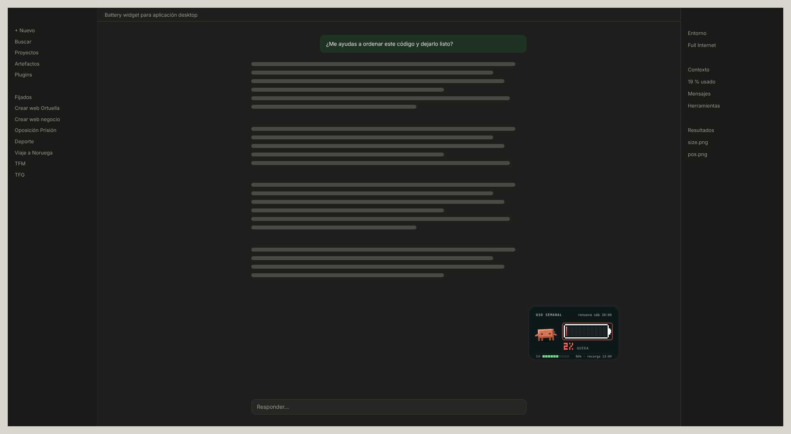
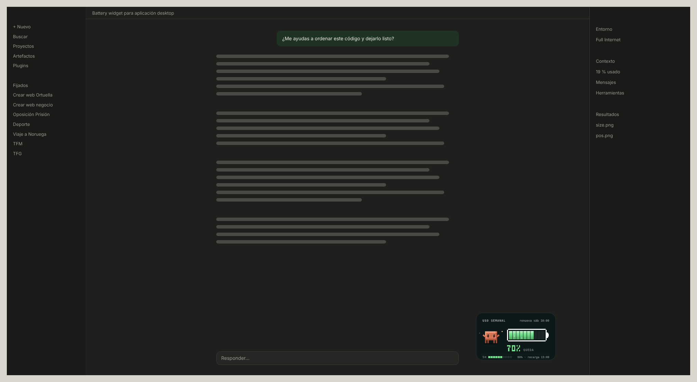
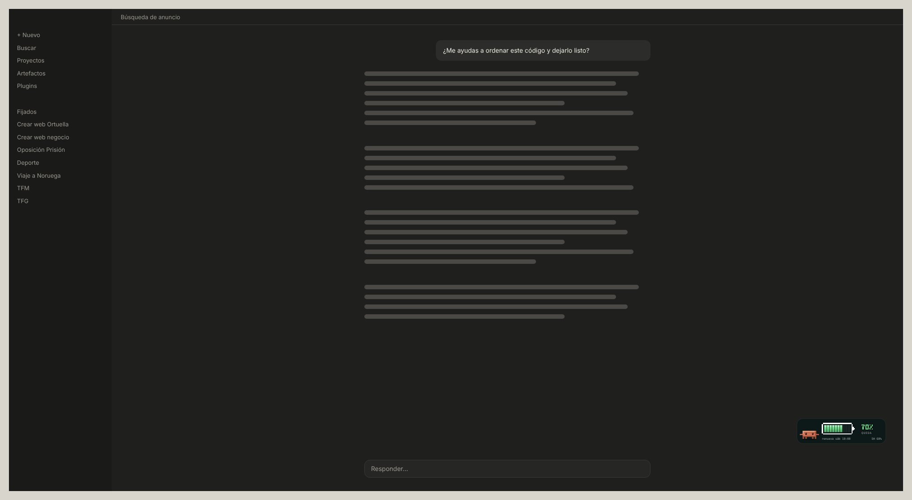

# Uso-Bateria 🔋

Clawd, la mascota de Claude, al lado de una **batería pixelada** que te dice cuánto te queda de tu uso **semanal** de Claude. Aparece en las sesiones de **Claude Code** de la app de escritorio, **pintada en el fondo** de la ventana, en el hueco libre junto al chat. La mueves con `/bateria-mover` y un clic, y lo ajustas todo con `/bateria-ajustes`.



<details>
<summary>Ver en modo claro, en un portátil y en modo panel</summary>

**Modo claro**


**Portátil (1440 × 900)**: con el panel derecho abierto apenas queda hueco junto al chat; usa `/bateria-mover`, o el tamaño `diminuto`.


**Modo panel** (simulación de cómo quedará cuando la app tenga paneles pequeños)



</details>

> Las capturas son simulaciones de Claude Code en la app de escritorio, con el panel derecho abierto, a 2000 × 1078 salvo la del portátil. El recuadro y sus animaciones son los reales.

## Dónde funciona

- ✅ En las sesiones de **Claude Code** de la app de escritorio (la pestaña **Code**) que trabajan en una carpeta de **tu ordenador**.
- ❌ En las **conversaciones normales** de Claude: allí la app no ejecuta el código de los plugins (solo usa sus habilidades y conectores), así que no se puede dibujar nada, ni panel ni fondo.
- ❌ En la terminal no se dibuja (solo sale una línea de texto con el porcentaje).
- ⏳ En las sesiones de Claude Code **en la nube**: el plugin se carga y sus comandos funcionan, pero hoy la app no se conecta a esas sesiones para dibujar mods (ni paneles ni fondos). `/bateria-diagnostico` lo muestra como *"no surface is attached"*. El plugin queda preparado: si la app empieza a conectarse, la batería aparecerá sola.

## Qué hace Clawd según la batería


| Te queda | Qué pasa |
| --- | --- |
| **Más del 60 %** | Clawd salta y saluda, con brillitos alrededor. Batería verde. |
| **21–60 %** | Camina de un lado a otro. Batería amarilla (verde por encima del 50 %). |
| **20 % o menos** | Está cansado y suda, la batería se pone roja y el borde parpadea. |
| **0 %** | Se queda dormido y le salen "z". |

Además:
- **Arriba a la derecha** sale cuándo se renueva el límite semanal (`renueva sáb 10:00`, o `renueva hoy 10:00` si es el mismo día).
- **En la fila de abajo** (`5H`) está el límite de 5 horas y a qué hora se recarga (`60% · recarga 13:00`).
- Los números se actualizan después de cada respuesta de Claude, y el reloj cada minuto.

## Tres modos

| | **Fondo** (por defecto) | **Panel** | **Auto** |
| --- | --- | --- | --- |
| Dónde sale | Pintada en el fondo de la ventana, junto al chat | En un panel de la app | En el panel; si la app no lo muestra, en el fondo |
| Cómo se mueve | Con `/bateria-mover` y un clic, o con la posición | Lo coloca la app | Según dónde esté |
| Paneles abiertos (Hilos, Contexto…) | Un panel puede taparla: muévela con `/bateria-mover` | La app lo recoloca | — |
| Fondos y temas | Ocupa el fondo: no se combina con otro tema que ponga fondo | Compatible con cualquiera | — |
| Hoy | ✅ Funciona en sesiones locales | ⚠️ La app lo abre como panel lateral grande, no como mini panel | ⚠️ Igual que panel |

El mini panel pequeño en una esquina depende de una función que la app todavía no tiene: el plugin ya lo pide, así que cuando la app lo añada bastará con `/bateria-ajustes modo panel`.

Para cambiar de modo: `/bateria-ajustes modo fondo` (o `panel`, `auto`). Se aplica al momento.

## Instalación

Necesitas **Claude Desktop** (la app de escritorio). Elige la forma que te resulte más cómoda; todas instalan lo mismo.

### Opción 1: desde la app, con botones

1. Abre la página de **Plugins**: en el menú de la izquierda, o con el botón **+** de la caja donde escribes.
2. Pulsa el botón **Añadir**, arriba a la derecha (al lado del embudo). **No uses el buscador:** solo busca en el catálogo oficial y este plugin no sale ahí.
3. En el menú que se abre, elige **Añadir marketplace** (la última opción; en inglés, *Add marketplace*) y escribe:
   ```
   Lehendakari02/Uso-Bateria
   ```
4. Aparece la tarjeta **Uso bateria**: pulsa el botón **+** para instalarla (**Probar** solo abre un chat de prueba).
5. **Abre una sesión nueva de Claude Code** en una carpeta de tu ordenador y escribe cualquier mensaje. La batería aparece en un panel; si no, escribe `/bateria`.

### Opción 2: con un comando en Claude Code

En el chat de una sesión de Claude Code, escribe:

```
/plugin install uso-bateria --marketplace Lehendakari02/Uso-Bateria
```

Si tu versión no acepta `--marketplace`, hazlo en dos pasos:

```
/plugin marketplace add Lehendakari02/Uso-Bateria
```

```
/plugin install uso-bateria@uso-bateria
```

### Opción 3: desde la terminal de tu ordenador

```bash
claude plugin install uso-bateria --marketplace Lehendakari02/Uso-Bateria
```

O en dos pasos:

```bash
claude plugin marketplace add Lehendakari02/Uso-Bateria
```

```bash
claude plugin install uso-bateria@uso-bateria
```

### Opción 4: pidiéndoselo a Claude

En una sesión de Claude Code **en tu ordenador** (no en la nube), escribe algo como:

> Instala el plugin `uso-bateria` del marketplace `Lehendakari02/Uso-Bateria`.

Claude ejecutará los comandos de la opción 3 y te pedirá permiso antes.

En todos los casos, **abre una sesión nueva** al terminar.

## Actualizar

Cuando haya una versión nueva, la app la descarga sola al refrescar el marketplace. Para forzarlo desde la terminal:

```bash
claude plugin marketplace update uso-bateria
```

```bash
claude plugin update uso-bateria@uso-bateria
```

Después abre una sesión nueva. Para saber qué versión tienes: `claude plugin list`. Si te faltan comandos de los que salen aquí (por ejemplo `/bateria-ajustes`), tienes una versión antigua.

## Comandos

Se escriben en el chat:

| Comando | Qué hace |
| --- | --- |
| `/bateria` | Vuelve a abrir el mini panel si lo has cerrado. |
| `/bateria-ajustes` | Muestra los ajustes y los cambia al momento (ver **Ajustes**). |
| `/bateria-mover` | **En el fondo:** la batería se marca con un borde que parpadea y el aviso *"Haz clic donde quieras ponerme"*. El siguiente clic en un hueco vacío de la ventana la coloca ahí. Escríbelo otra vez para cancelar. |
| `/bateria-diagnostico` | Si no ves la batería: te dice qué ha contestado la app al pedirle el mini panel y el fondo, y si hay datos de uso. |
| `/bateria-reset` | **En el fondo:** devuelve la batería a la posición de los ajustes. |


El sitio que eliges con `/bateria-mover` se recuerda aunque cierres la app, hasta que uses `/bateria-reset` o cambies la posición en los ajustes. No hace falta tocar la batería primero, y un clic normal nunca la mueve: solo el clic que viene después de `/bateria-mover`.

## Ajustes

### Desde el chat: `/bateria-ajustes` (lo más fácil)

Escribe `/bateria-ajustes` y verás los ajustes actuales. Para cambiar uno, añade el ajuste y el valor; puedes usar palabras en castellano:

```
/bateria-ajustes tamaño grande
```

```
/bateria-ajustes estilo compacto posición abajo-izquierda
```

```
/bateria-ajustes modo fondo
```

Los cambios se ven al momento y se guardan para las próximas sesiones. Para volver a los ajustes del plugin: `/bateria-ajustes reset`.

| Ajuste | Valores | Por defecto |
| --- | --- | --- |
| `modo` | `fondo`, `panel`, `auto` | `fondo` |
| `posición` (en el fondo) | `abajo-derecha`, `derecha`, `arriba-derecha`, `abajo-izquierda`, `izquierda`, `arriba-izquierda` | `abajo-derecha` |
| `tamaño` | `diminuto`, `pequeño`, `mediano`, `grande`, `muy-grande` | `pequeño` |
| `estilo` | `completo`, `compacto` | `completo` |
| `opacidad` (del recuadro) | `sólido`, `normal`, `cristal` | `normal` |
| `idioma` | `español`, `inglés` | `español` |
| `móvil` | `ocultar`, `mostrar` | `ocultar` |

También valen los nombres en inglés (`size large`, `style compact`, `position bottom-left`…).

### Desde la configuración del plugin

Son los mismos ajustes. Lo que cambies con `/bateria-ajustes` tiene prioridad. Después de cambiarlos, abre una sesión nueva.

- **En la app:** **Plugins** → **Uso bateria** → pestaña **Ajustes** → **Guardar**.

- **En el chat de Claude Code:**
  ```
  /plugin configure uso-bateria@uso-bateria
  ```
- **Desde la terminal**, al instalar (puedes poner varios `--config`):
  ```bash
  claude plugin install uso-bateria --marketplace Lehendakari02/Uso-Bateria --config size=medium
  ```
  O después, con los valores que quieras cambiar:
  ```bash
  echo '{"size":"medium","style":"full"}' | claude plugin configure uso-bateria@uso-bateria --values-stdin
  ```

> En la app: **Plugins** → **Uso bateria** → pestaña **Ajustes**, y pulsa **Guardar**. Esos valores se guardan en tu ordenador y los usan las sesiones locales nuevas.

### Tamaños

En el mini panel cada tamaño tiene un ancho fijo, sea cual sea la ventana:


En el fondo el recuadro crece con la ventana: `pequeño` mide unos 220 px de ancho en un monitor de 1920 px.

### Estilo

- `full` (por defecto): el recuadro completo, con cabecera (`USO SEMANAL`), cuándo se renueva y el límite de 5 horas con su hora de recarga.
- `compact`: una tira baja con Clawd, la batería, el porcentaje, cuándo se renueva y el `5H`.



### Posiciones (en el fondo)

En el fondo, el recuadro va **en el hueco libre al lado del chat**: a la derecha, entre el chat y el panel derecho de la app (las `derecha`), o a la izquierda, entre la barra lateral y el chat (las `izquierda`). Las `abajo` lo bajan y las `arriba` lo suben, sin cortarlo ni meterlo debajo de la barra de arriba. Si ninguna te encaja, usa `/bateria-mover`.


### Fondo del recuadro


`solid` es totalmente opaco, `normal` es casi opaco y `glass` deja ver un poco lo que hay detrás.

### Idioma

Los textos del recuadro salen **en castellano** (`USO SEMANAL`, `QUEDA`, `renueva`, `recarga` y los días de la semana). Para verlos en inglés: `/bateria-ajustes idioma inglés`.

### En el móvil

En la app del móvil no hay sitio libre al lado del chat, así que la batería viene **oculta** (`hide`). Si la quieres ver: `/bateria-ajustes móvil mostrar`.

## Preguntas frecuentes

**¿Gasta tokens?**
No. Solo lee los números de uso que Claude ya tiene y no llama a la IA. Tampoco envía nada a ningún sitio.

**¿Qué número muestra?**
Con un plan Pro o Max, el límite semanal. Si usas Claude con una clave de API (sin límites de plan), muestra cuánto te queda de la ventana de contexto.

**¿La puedo arrastrar con el ratón?**
No: la app no avisa a los plugins cuando arrastras el ratón. En el mini panel la coloca la app. En el fondo, usa `/bateria-mover` y haz clic donde la quieras.

**¿Sale en las conversaciones normales de Claude?**
No. Allí la app no ejecuta el código de los plugins, ni para paneles ni para fondos. Solo en Claude Code.

**He cerrado el mini panel, ¿cómo lo recupero?**
Escribe `/bateria`, o abre una sesión nueva.

**Lo he instalado y no sale nada.**
1. Comprueba que estás en una sesión de **Claude Code** (pestaña **Code**) de tu ordenador, no en una conversación normal.
2. Abre una sesión **nueva** después de instalar y envía un mensaje.
3. Escribe `/bateria-diagnostico` y mira qué ha contestado la app. Si te dice que el comando no existe, el plugin no está cargado en Claude Code: instálalo con la **opción 3** (terminal) y abre otra sesión.
4. En la terminal, `claude plugin list` debe mostrar `uso-bateria@uso-bateria` como *enabled*.

**¿Funciona con otros temas o fondos?**
En el mini panel, sí, con cualquiera. En el fondo, la batería ocupa el fondo de la ventana, y ahí solo cabe una cosa: si otro plugin pone un fondo o una foto, se pisan y solo se ve uno.

**¿Y si en mi sistema está activado "reducir movimiento"?**
Clawd y la batería se quedan quietos.

**¿Cómo lo quito?**
En **+** → **Plugins**, desactiva o elimina `uso-bateria`, o escribe `claude plugin uninstall uso-bateria` en la terminal. Después abre una sesión nueva.

## Estado

Probado en Claude Code local de la app de escritorio: el modo fondo, `/bateria-mover`, `/bateria-ajustes` y `/bateria-diagnostico` funcionan. Pendiente de la app: el mini panel pequeño y las sesiones en la nube. Si algo no se ve bien, abre un *issue* en este repositorio con una captura.

## Créditos

El dibujo de Clawd, la batería pixelada y sus animaciones parten de [usage-battery](https://github.com/Handsher/usage-battery), de Handsher. Licencia MIT (ver [LICENSE](LICENSE)). Proyecto de fans, sin relación con Anthropic.
