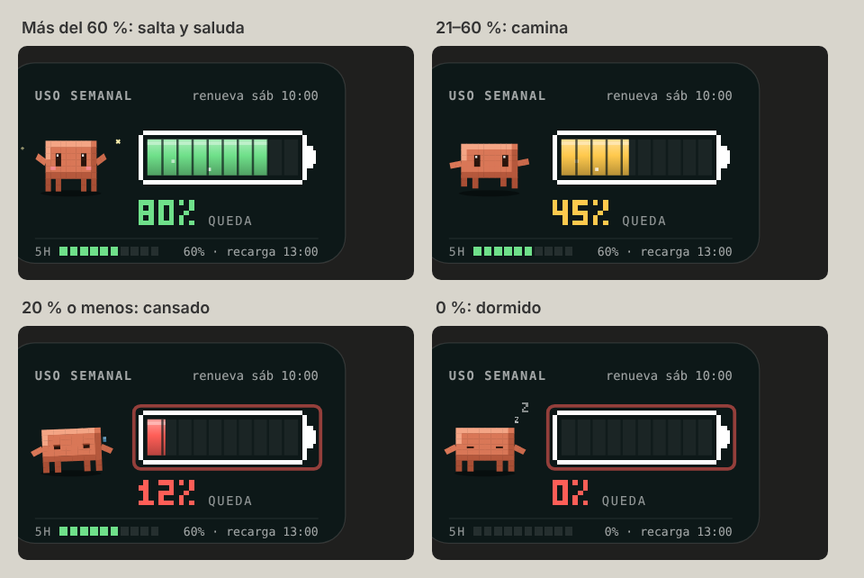
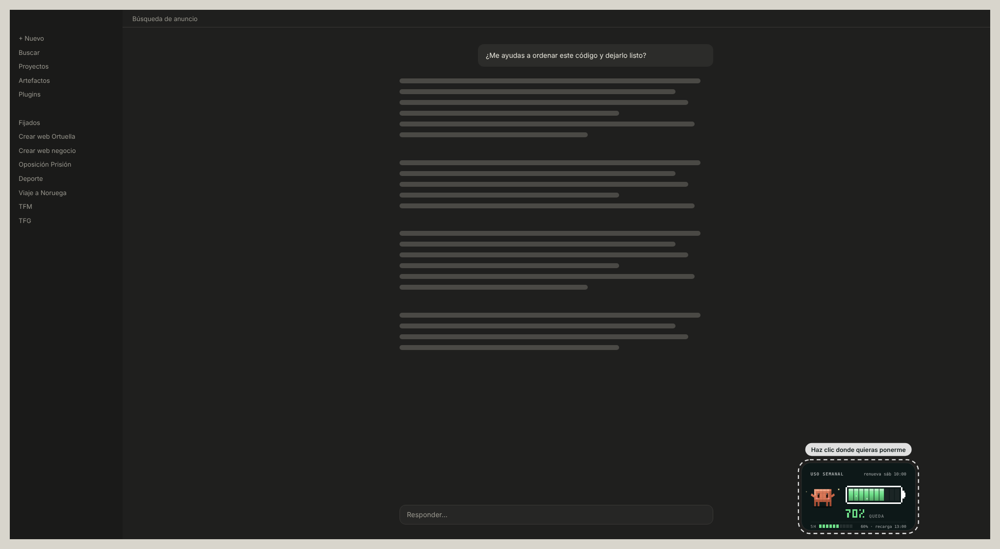
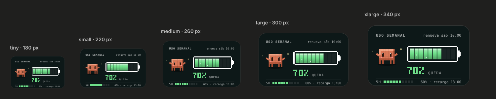
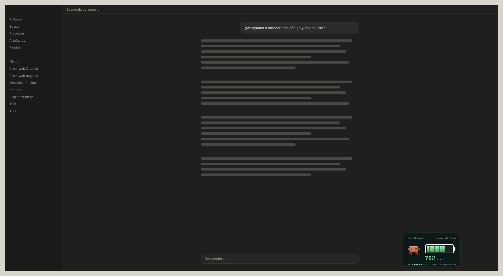

# Uso-Bateria 🔋

Clawd, la mascota de Claude, al lado de una **batería pixelada** que te dice cuánto te queda de tu uso **semanal** de Claude. Vive en un **mini panel** de **Claude Desktop** que la propia app coloca en una esquina del chat. Cuando abres o cierras paneles se recoloca solo, y funciona con cualquier fondo o tema que tengas.


<details>
<summary>Ver en Claude Code, en modo claro y en un portátil</summary>

**Claude Code con el panel de la derecha abierto**


**Claude Code con la lista de hilos abierta**


**Modo claro**


**Portátil (1440 × 900)**


</details>

> Las capturas son simulaciones de Claude Desktop (a 2000 × 1080, salvo la del portátil). El recuadro y sus animaciones son los reales; el sitio exacto del mini panel lo decide la app.

## Qué hace Clawd según la batería



| Te queda | Qué pasa |
| --- | --- |
| **Más del 60 %** | Clawd salta y saluda, con brillitos alrededor. Batería verde. |
| **21–60 %** | Camina de un lado a otro. Batería amarilla (verde por encima del 50 %). |
| **20 % o menos** | Está cansado y suda, la batería se pone roja y el borde parpadea. |
| **0 %** | Se queda dormido y le salen "z". |

Además:
- **Arriba a la derecha** sale cuándo se renueva el límite semanal (`renueva sáb 10:00`, o `renueva hoy 10:00` si es el mismo día).
- **En la fila de abajo** (`5H`) está el límite de 5 horas y a qué hora se recarga (`60% · recarga 13:00`).
- Los números se actualizan después de cada respuesta de Claude, y el reloj cada minuto.

## Dos modos

| | **Panel** (por defecto) | **Fondo** |
| --- | --- | --- |
| Dónde sale | Un mini panel que la app coloca en una esquina del chat | Pintado en el fondo de la ventana |
| Paneles abiertos (Hilos, Contexto…) | La app lo recoloca para que no se tape | Un panel abierto lo puede tapar |
| Fondos y temas | Compatible con cualquiera | Ocupa el fondo: no se puede combinar con otro tema que ponga fondo |
| Cómo se mueve | Lo coloca la app; lo puedes minimizar o ampliar | Con `/bateria-mover` y un clic, o con la opción **Position** |
| Tamaño | Fijo en píxeles | Crece con la ventana |

El modo se cambia en los ajustes, en la opción **Mode**.

## Instalación

Necesitas **Claude Desktop** (la app de escritorio). Elige la forma que te resulte más cómoda; todas instalan lo mismo.

### Opción 1: desde la app, con botones

1. En la caja donde escribes a Claude, pulsa el botón **+**.
2. Entra en **Plugins**.
3. Pulsa **Add marketplace** y escribe:
   ```
   Lehendakari02/Uso-Bateria
   ```
4. Busca **uso-bateria** y pulsa **Add plugin**.
5. Elige los ajustes, o deja los de por defecto.
6. **Abre una sesión nueva.** La batería aparece en las sesiones que empiezan después de instalarla.

### Opción 2: con un comando en Claude Code

En el chat de una sesión de Claude Code, escribe:

```
/plugin install uso-bateria --marketplace Lehendakari02/Uso-Bateria
```

Si tu versión no acepta `--marketplace`, hazlo en dos pasos:

```
/plugin marketplace add Lehendakari02/Uso-Bateria
```

```
/plugin install uso-bateria@uso-bateria
```

### Opción 3: desde la terminal de tu ordenador

```bash
claude plugin install uso-bateria --marketplace Lehendakari02/Uso-Bateria
```

O en dos pasos:

```bash
claude plugin marketplace add Lehendakari02/Uso-Bateria
```

```bash
claude plugin install uso-bateria@uso-bateria
```

### Opción 4: pidiéndoselo a Claude

En una sesión de Claude Code **en tu ordenador** (no en la nube), escribe algo como:

> Instala el plugin `uso-bateria` del marketplace `Lehendakari02/Uso-Bateria`.

Claude ejecutará los comandos de la opción 3 y te pedirá permiso antes.

En todos los casos, **abre una sesión nueva** al terminar.

## Comandos

Se escriben en el chat:

| Comando | Qué hace |
| --- | --- |
| `/bateria` | Vuelve a abrir el mini panel si lo has cerrado. |
| `/bateria-mover` | **Modo fondo:** la batería se marca con un borde que parpadea y el aviso *"Haz clic donde quieras ponerme"*. El siguiente clic en un hueco vacío de la ventana la coloca ahí. Escríbelo otra vez para cancelar. |
| `/bateria-reset` | **Modo fondo:** devuelve la batería a la posición de los ajustes. |



El sitio que eliges con `/bateria-mover` se recuerda aunque cierres la app, hasta que uses `/bateria-reset` o cambies **Position** en los ajustes. No hace falta tocar la batería primero, y un clic normal nunca la mueve: solo el clic que viene después de `/bateria-mover`.

## Ajustes

Se cambian en el **menú de configuración del plugin**: botón **+** → **Plugins** → `uso-bateria`, o `/plugin` en Claude Code. Después de cambiar algo, abre una sesión nueva para verlo.

| Opción | Valores | Por defecto |
| --- | --- | --- |
| **Mode** (modo) | `panel`, `fondo` | `panel` |
| **Position** (posición, modo fondo) | `bottom-right`, `right`, `top-right`, `bottom-left`, `left`, `top-left` | `bottom-right` |
| **Size** (tamaño) | `tiny`, `small`, `medium`, `large`, `xlarge` | `small` |
| **Style** (estilo) | `full`, `compact` | `full` |
| **Card background** (fondo del recuadro) | `solid`, `normal`, `glass` | `normal` |
| **Language** (idioma del recuadro) | `es`, `en` | `es` |
| **On the phone** (en el móvil) | `hide`, `show` | `hide` |

### Tamaños

En modo panel cada tamaño tiene un ancho fijo, sea cual sea la ventana:



En modo fondo el recuadro crece con la ventana: `small` mide unos 220 px de ancho en un monitor de 1920 px.

### Estilo

- `full` (por defecto): el recuadro completo, con cabecera (`USO SEMANAL`), cuándo se renueva y el límite de 5 horas con su hora de recarga.
- `compact`: una tira baja con Clawd, la batería, el porcentaje, cuándo se renueva y el `5H`.


### Posiciones (modo fondo)

En modo fondo, el recuadro va **en el hueco libre al lado del chat**: entre el chat y el borde derecho (las `right`) o entre la barra lateral y el chat (las `left`). Las `bottom` lo ponen a la altura de la caja donde escribes; las `top` lo suben, sin meterlo debajo de la barra de arriba. Si ninguna te encaja, usa `/bateria-mover`.




### Fondo del recuadro


`solid` es totalmente opaco, `normal` es casi opaco y `glass` deja ver un poco lo que hay detrás.

### Idioma

Los textos del recuadro salen **en castellano** (`USO SEMANAL`, `QUEDA`, `renueva`, `recarga` y los días de la semana). Para verlos en inglés, pon `en` en **Language**.

### En el móvil

En la app del móvil no hay sitio libre al lado del chat, así que la batería viene **oculta** (`hide`). Si la quieres ver, pon `show`.

## Preguntas frecuentes

**¿Gasta tokens?**
No. Solo lee los números de uso que Claude ya tiene y no llama a la IA. Tampoco envía nada a ningún sitio.

**¿Qué número muestra?**
Con un plan Pro o Max, el límite semanal. Si usas Claude con una clave de API (sin límites de plan), muestra cuánto te queda de la ventana de contexto.

**¿La puedo arrastrar con el ratón?**
No: la app no avisa a los plugins cuando arrastras el ratón. En modo panel la coloca la app. En modo fondo, usa `/bateria-mover` y haz clic donde la quieras.

**He cerrado el mini panel, ¿cómo lo recupero?**
Escribe `/bateria`, o abre una sesión nueva.

**¿Funciona con otros temas o fondos?**
En modo panel, sí, con cualquiera. En modo fondo, la batería ocupa el fondo de la ventana, y ahí solo cabe una cosa: si otro plugin pone un fondo o una foto, se pisan y solo se ve uno.

**¿Y si en mi sistema está activado "reducir movimiento"?**
Clawd y la batería se quedan quietos.

**¿Cómo lo quito?**
En **+** → **Plugins**, desactiva o elimina `uso-bateria`, o escribe `claude plugin uninstall uso-bateria` en la terminal. Después abre una sesión nueva.

## Estado

Es un proyecto en marcha. El modo panel y `/bateria-mover` son nuevos y aún se están probando en la app real. Si algo no se ve bien, abre un *issue* en este repositorio con una captura.

## Créditos

El dibujo de Clawd, la batería pixelada y sus animaciones parten de [usage-battery](https://github.com/Handsher/usage-battery), de Handsher. Licencia MIT (ver [LICENSE](LICENSE)). Proyecto de fans, sin relación con Anthropic.
