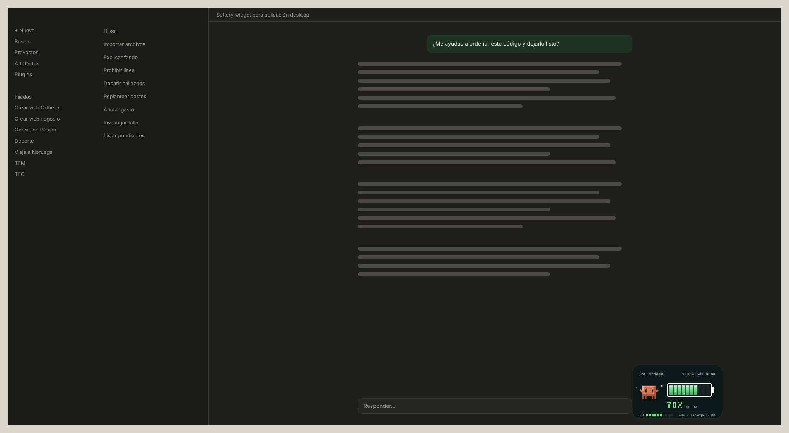
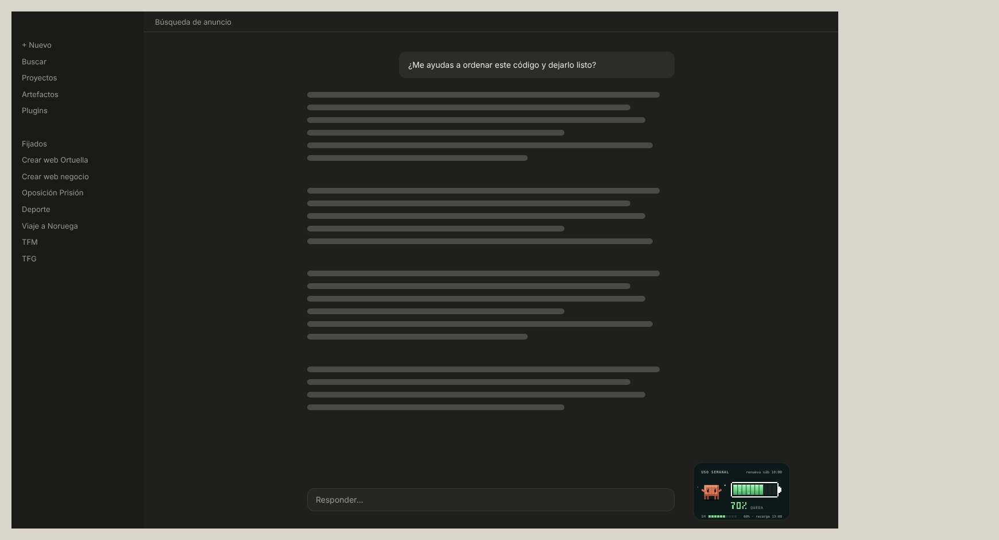
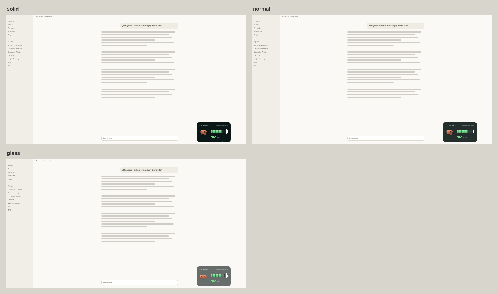

# Uso-Bateria 🔋

Clawd (la mascota de Claude) al lado de una **batería pixelada** que muestra cuánto te queda de tu uso **semanal** de Claude. Es un recuadro pequeño que se queda **abajo, al lado de la caja donde escribes**, en **Claude Desktop**, y se mueve solo. Lo puedes cambiar de sitio **con un doble clic**.

Es una versión modificada de [Handsher/usage-battery](https://github.com/Handsher/usage-battery). Solo muestra el recuadro, **sin el fondo verde pixelado** en toda la ventana. La app conserva sus colores normales, y el recuadro se coloca en el hueco libre junto al chat para no taparlo.


<details>
<summary>Ver en Claude Code, en modo claro, en un portátil y en versión grande</summary>

**Claude Code con el panel de la derecha abierto** (colocado con doble clic junto a la caja de escribir)


**Claude Code (con la lista de hilos abierta)**



**Modo claro**


**Portátil (1440 × 900)**



**Estilo `compact`** (una tira baja, más discreta)


</details>

> Las capturas son una simulación de la ventana de Claude Desktop (a 2000 × 1080 salvo la del portátil) para que te hagas una idea. El recuadro y sus animaciones son los reales.

## Qué hace Clawd según la batería


| Te queda | Qué pasa |
| --- | --- |
| **Más del 60 %** | Clawd salta y saluda, con brillitos alrededor. Batería verde. |
| **21–60 %** | Camina de un lado a otro. Batería amarilla (verde por encima del 50 %). |
| **20 % o menos** | Está cansado y suda, la batería se pone roja y el borde parpadea. |
| **0 %** | Se queda dormido y le salen "z". |

Además:
- **Arriba a la derecha** del recuadro sale cuándo se renueva el límite semanal (por ejemplo `renueva sáb 10:00`, o `renueva hoy 10:00` si es el mismo día).
- **En la fila de abajo** (`5H`) está el límite de 5 horas y a qué hora se recarga (`60% · recarga 13:00`).
- Los números se actualizan después de cada respuesta de Claude, y el reloj cada minuto.

## Instalación

Necesitas **Claude Desktop** (la app de escritorio). Elige la forma que te resulte más cómoda; todas instalan lo mismo.

### Opción 1: desde la app, con botones

1. En la caja donde escribes a Claude, pulsa el botón **+**.
2. Entra en **Plugins**.
3. Pulsa **Add marketplace** y escribe:
   ```
   Lehendakari02/Uso-Bateria
   ```
4. Busca **usage-battery-solo** y pulsa **Add plugin**.
5. Elige la posición y el tamaño, o deja los de por defecto.
6. **Abre una sesión nueva.** El recuadro aparece en las sesiones que empiezan después de instalarlo.

### Opción 2: con un comando en Claude Code

En el chat de una sesión de Claude Code, escribe:

```
/plugin install usage-battery-solo --marketplace Lehendakari02/Uso-Bateria
```

Si tu versión no acepta `--marketplace`, hazlo en dos pasos:

```
/plugin marketplace add Lehendakari02/Uso-Bateria
```

```
/plugin install usage-battery-solo@usage-battery-solo
```

### Opción 3: desde la terminal de tu ordenador

```bash
claude plugin install usage-battery-solo --marketplace Lehendakari02/Uso-Bateria
```

O en dos pasos:

```bash
claude plugin marketplace add Lehendakari02/Uso-Bateria
```

```bash
claude plugin install usage-battery-solo@usage-battery-solo
```

### Opción 4: pidiéndoselo a Claude

En una sesión de Claude Code **en tu ordenador** (no en la nube), escribe algo como:

> Instala el plugin `usage-battery-solo` del marketplace `Lehendakari02/Uso-Bateria`.

Claude ejecutará los comandos de la opción 3 y te pedirá permiso antes.

En todos los casos, **abre una sesión nueva** al terminar.

## Moverlo con el ratón: doble clic

Haz **doble clic en cualquier hueco vacío** de la ventana (donde no haya texto, botones ni paneles) y Clawd se va justo ahí, centrado en el punto donde has hecho clic. Se queda en ese sitio aunque cierres la app.

- Para que quede bien, haz el doble clic en el **centro del hueco** donde lo quieres.
- Para devolverlo a la posición de los ajustes, escribe `/bateria-reset` en el chat de Claude Code, o elige otra **Position** en los ajustes.
- Arrastrarlo no se puede: la app no avisa a los mods cuando mueves el ratón, solo cuando haces clic.

## Ajustes: posición, tamaño, estilo, fondo, idioma y móvil

Se cambian en el **menú de configuración del plugin**: botón **+** → **Plugins** → `usage-battery-solo`, o `/plugin` en Claude Code. Después de cambiar algo, abre una sesión nueva para verlo.

| Opción | Valores | Por defecto |
| --- | --- | --- |
| **Position** (posición) | `bottom-right`, `right`, `top-right`, `bottom-left`, `left`, `top-left` | `bottom-right` |
| **Size** (tamaño) | `tiny`, `small`, `medium`, `large`, `xlarge` | `small` |
| **Style** (estilo) | `full`, `compact` | `full` |
| **Card background** (fondo del recuadro) | `solid`, `normal`, `glass` | `normal` |
| **On the phone** (en el móvil) | `hide`, `show` | `hide` |
| **Language** (idioma del recuadro) | `es`, `en` | `es` |

### Posiciones

El recuadro siempre va **en el hueco libre al lado del chat**: centrado entre el chat y el borde de la ventana (las `right`) o entre la barra lateral y el chat (las `left`). Las `bottom` lo ponen **a la altura de la caja donde escribes**; las `top` lo suben, sin meterlo debajo de la barra de arriba. Si ninguna te encaja, usa el doble clic.


### Tamaños

El recuadro crece con la ventana. Con una ventana a pantalla completa en un monitor de 1920 px, `small` (el de por defecto) mide unos 220 px de ancho y `medium`, unos 270 px. `tiny` es aún más pequeño, pero sus letras cuestan de leer.


En portátiles o ventanas estrechas, quédate en `medium` o menos. `large` y `xlarge` necesitan una ventana ancha.

### Estilo

- `full` (por defecto): el recuadro completo, con cabecera (`USO SEMANAL`), cuándo se renueva y la fila del límite de 5 horas con su hora de recarga.
- `compact`: una tira baja con Clawd, la batería, el porcentaje, cuándo se renueva y el `5H`. Más discreta (ver la captura de arriba).

### Fondo del recuadro



`solid` es totalmente opaco, `normal` es casi opaco y `glass` deja ver un poco lo que hay detrás.

### Idioma

Los textos del recuadro salen **en castellano** (`USO SEMANAL`, `QUEDA`, `renueva`, `recarga` y los días de la semana). Si algún amigo lo prefiere en inglés, que ponga `en` en **Language**.

### En el móvil

En la app del móvil no hay hueco al lado del chat: el recuadro quedaría detrás de los mensajes. Por eso viene **oculto en el móvil** (`hide`). Si aun así lo quieres ver, pon `show`.

## Preguntas frecuentes

**¿Gasta tokens?**
No. Solo lee los números de uso que Claude ya tiene y no llama a la IA. Tampoco envía nada a ningún sitio.

**¿Qué número muestra?**
Con un plan Pro o Max, el límite semanal. Si usas Claude con una clave de API (sin límites de plan), muestra cuánto te queda de la ventana de contexto.

**¿Lo puedo arrastrar con el ratón?**
Arrastrar no, pero sí moverlo con un **doble clic** en el hueco donde lo quieras (ver arriba).

**En Claude Code, cuando abro el panel de la derecha (Hilos, Contexto...), no se ve.**
Es normal: el recuadro está en el fondo de la ventana, y ese panel lo tapa. Haz **doble clic en el hueco libre entre la caja de escribir y el panel** y se queda ahí (como en la captura de arriba).

**¿Funciona junto con otros temas?**
Funciona perfectamente con los colores normales de la app, en modo claro y oscuro. Pero el recuadro se dibuja en el "fondo" de la ventana, y en ese hueco solo puede haber una cosa a la vez: si instalas otro mod que pone un fondo o una foto, se pisarán y solo se verá uno de los dos.

**¿Y si en mi sistema está activado "reducir movimiento"?**
El recuadro se queda quieto.

**¿Cómo lo quito?**
En **+** → **Plugins**, desactiva o elimina `usage-battery-solo`, o con `claude plugin uninstall usage-battery-solo`. Después abre una sesión nueva.

## Cambios respecto al original

- Se quitó el suelo verde pixelado y la viñeta oscura: fuera del recuadro, la ventana se ve como siempre.
- Ya no obliga a usar el modo oscuro: la app mantiene tu modo claro u oscuro.
- El recuadro va en el hueco libre junto al chat, no pegado a las esquinas de la ventana; por defecto, abajo, a la altura de la caja de escribir. En ventanas estrechas se aparta un poco más.
- Tamaños más pequeños (el `xlarge` de aquí es el `medium` del original) y uno nuevo, `tiny`.
- Estilo nuevo `compact`, una tira baja y discreta; el recuadro completo (`full`) sigue siendo el de por defecto.
- Se puede mover con un doble clic en un hueco vacío, y volver con `/bateria-reset`.
- Opción nueva **Card background** (`solid`, `normal`, `glass`).
- Opción nueva **On the phone**: oculto en el móvil por defecto.
- Textos del recuadro traducidos al castellano, con opción **Language** para volver al inglés.
- Nombre nuevo, `usage-battery-solo`, para que no se mezcle con el original.

## Créditos y licencia

Basado en [usage-battery](https://github.com/Handsher/usage-battery) de Handsher, con licencia MIT (ver [LICENSE](LICENSE)). Este mod lo han hecho fans y no está afiliado a Anthropic.
