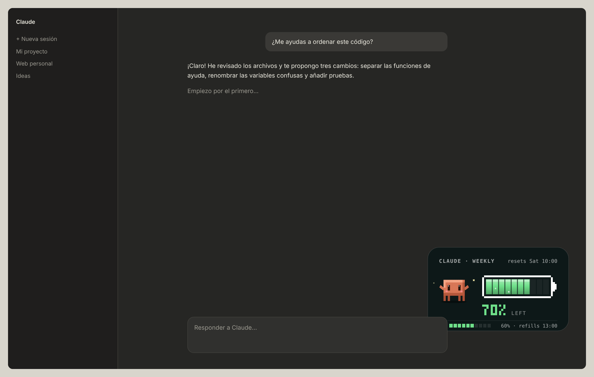
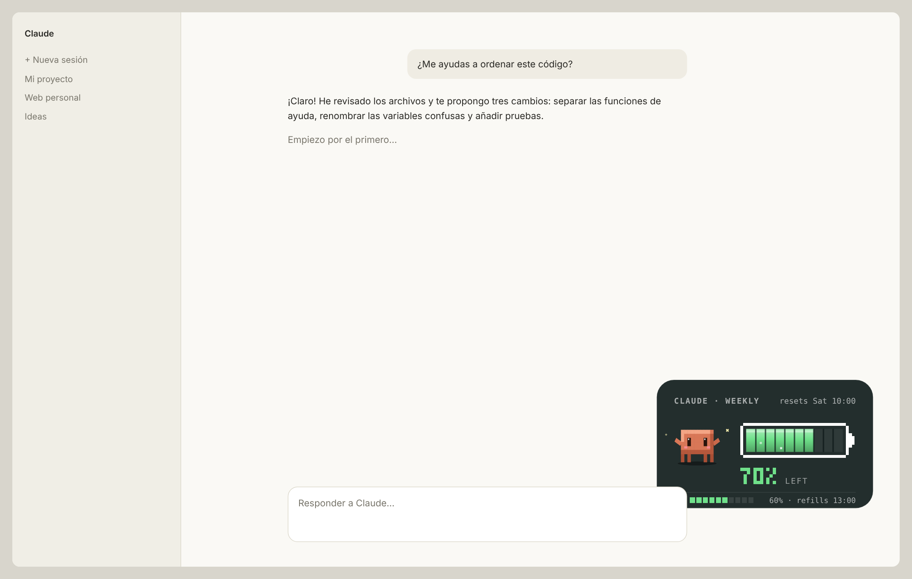
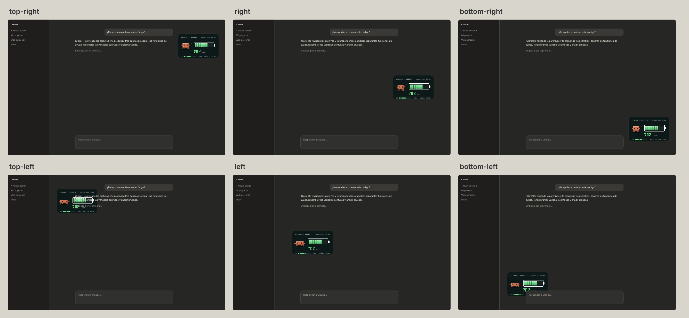

# Uso-Bateria 🔋

Clawd (la mascota de Claude) al lado de una **batería pixelada** que muestra cuánto te queda de tu uso **semanal** de Claude. Aparece en un recuadro en una esquina de **Claude Desktop** y se mueve solo.

Es una versión modificada de [Handsher/usage-battery](https://github.com/Handsher/usage-battery): solo muestra el recuadro, **sin el fondo verde pixelado** en toda la ventana, y deja la app con sus colores normales.



<details>
<summary>Ver en modo claro</summary>



</details>

> Las capturas son una simulación de la ventana de Claude Desktop, para que te hagas una idea. El recuadro y sus animaciones son los reales.

## Qué hace Clawd según la batería


| Te queda | Qué pasa |
| --- | --- |
| **Más del 60 %** | Clawd salta y saluda, con brillitos alrededor. Batería verde. |
| **21–60 %** | Camina de un lado a otro. Batería amarilla (verde por encima del 50 %). |
| **20 % o menos** | Está cansado y suda, la batería se pone roja y el borde parpadea. |
| **0 %** | Se queda dormido y le salen "z". |

Además:
- **Arriba a la derecha** sale cuándo se reinicia el límite semanal (por ejemplo `resets Sat 10:00`).
- **En la fila de abajo** (`5H`) tienes el límite de 5 horas y a qué hora se recarga.
- Los números se actualizan después de cada respuesta de Claude, y el reloj cada minuto.

## Instalación

Necesitas **Claude Desktop** (la app de escritorio). En la terminal no se ve nada, porque la terminal no tiene fondo.

### Desde la app de escritorio (lo más fácil)

1. En la caja donde escribes a Claude, pulsa el botón **+**.
2. Entra en **Plugins**.
3. Pulsa **Add marketplace** y escribe:
   ```
   Lehendakari02/Uso-Bateria
   ```
4. Busca **usage-battery-solo** y pulsa **Add plugin**.
5. Elige la posición y el tamaño (o deja los de por defecto).
6. **Abre una sesión nueva.** El recuadro aparece en las sesiones que empiezan después de instalarlo.

### Desde una terminal de Claude Code

Escribe esto en el chat de Claude Code:

```
/plugin install usage-battery-solo --marketplace Lehendakari02/Uso-Bateria
```

O desde la terminal normal (fuera de Claude):

```bash
claude plugin install usage-battery-solo --marketplace Lehendakari02/Uso-Bateria
```

## Ajustes: posición, tamaño y fondo

Se cambian desde el **menú de configuración del plugin** (en **+** → **Plugins**, el plugin `usage-battery-solo`). Después de cambiar algo, abre una sesión nueva para verlo.

| Opción | Valores | Por defecto |
| --- | --- | --- |
| **Position** (posición) | `top-right`, `right`, `bottom-right`, `top-left`, `left`, `bottom-left` | `bottom-right` |
| **Size** (tamaño) | `tiny`, `small`, `medium`, `large`, `xlarge` | `large` |
| **Card background** (fondo del recuadro) | `solid`, `normal`, `glass` | `normal` |

### Posiciones



Las posiciones de la izquierda se apartan un poco para no quedar debajo de la barra lateral.

### Tamaños


Si en tu pantalla el recuadro choca con la caja de escribir, prueba un tamaño más pequeño o la posición `right`.

### Fondo del recuadro


`solid` es totalmente opaco, `normal` es casi opaco y `glass` deja ver un poco lo que hay detrás.

## Preguntas frecuentes

**¿Gasta tokens?**
No. Solo lee los números de uso que Claude ya tiene y no llama a la IA. Tampoco envía nada a ningún sitio.

**¿Qué número muestra?**
Con un plan Pro o Max, el límite semanal. Si usas Claude con una clave de API (sin límites de plan), muestra cuánto te queda de la ventana de contexto.

**¿Lo puedo arrastrar con el ratón?**
No. Se coloca en una de las seis posiciones de los ajustes.

**¿Funciona junto con otros temas?**
Funciona perfectamente con los colores normales de la app, en modo claro y oscuro. Pero el recuadro se dibuja en el "fondo" de la ventana, y en ese hueco solo puede haber una cosa a la vez: si instalas otro mod que pone un fondo o una foto, se pisarán y solo se verá uno de los dos.

**¿Y si alguien pide menos animaciones?**
Si tu sistema tiene activado "reducir movimiento", el recuadro se queda quieto.

**¿Cómo lo quito?**
En **+** → **Plugins**, desactiva o elimina `usage-battery-solo` y abre una sesión nueva.

## Cambios respecto al original

- Se quitó el suelo verde pixelado y la viñeta oscura: fuera del recuadro, la ventana se ve como siempre.
- Ya no obliga a usar el modo oscuro: la app mantiene tu modo claro u oscuro.
- Posición nueva: `left`. Tamaños nuevos: `tiny` y `xlarge`.
- Opción nueva **Card background** (`solid`, `normal`, `glass`).
- Por defecto: abajo a la derecha y en tamaño grande.
- Nombre nuevo, `usage-battery-solo`, para que no se mezcle con el original.

## Créditos y licencia

Basado en [usage-battery](https://github.com/Handsher/usage-battery) de Handsher, con licencia MIT (ver [LICENSE](LICENSE)). Este mod lo han hecho fans y no está afiliado a Anthropic.
